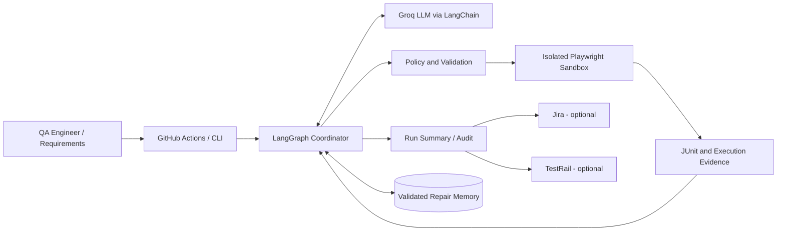
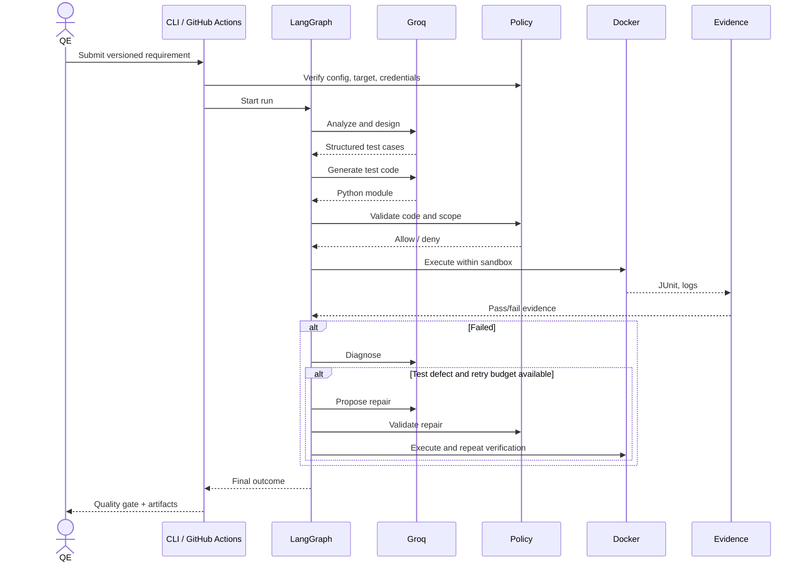

# High-Level Design (HLD)

**Status:** Target architecture with implementation gaps explicitly identified.

## 1. Architectural principles
- LangGraph coordinates **bounded** specialist tasks; deterministic Python owns execution, policies and reporting.
- Groq is a model provider, not an execution environment or source of truth.
- Generated code and requirements are untrusted inputs.
- Approval gates separate test proposals from changes to validated expectations.
- Keep one repository and one graph until scale justifies distributed services.

## 2. Context diagram

## 3. Agent architecture
| Agent | Input | Output | Deterministic gate |
|---|---|---|---|
| Requirement Analyst | Requirement text | Testable behavior, ambiguities | Input size, provenance and redaction |
| Test Designer | Analysis | Structured Cases | Pydantic schema, bounded count, traceability |
| Code Generator | Cases + approved target | Python source | AST policy, package allowlist, review |
| Execution Worker | Validated source | JUnit + stdout + status | Docker security policy, timeouts |
| Failure Analyst | Failure evidence | Diagnosis category + rationale | Retry eligibility and severity |
| Repair Agent | Test defect + evidence | Candidate source | Preserve assertions, bounded retries, independent validation |
| Reporting (deterministic) | All stage outputs | Run summary + artifacts | Schema checks, CI exit code |

## 4. Execution sequence

## 5. Deployment
- **Developer:** local Python CLI + Docker image, local SQLite for prototyping.
- **CI:** GitHub-hosted Linux runner builds sandbox and uploads evidence; job uses a protected `qa` environment.
- **Production target:** isolated self-hosted runner with egress policy, ephemeral credentials, approved test-data environment, artifact storage, durable audit and repair store.
- Do not treat the current Docker bridge network as a network security boundary.

## 6. Data boundaries
1. Requirement text may contain proprietary content; redact before sending to Groq.
2. Generated Python is untrusted; static filtering alone cannot guarantee safe execution.
3. Browser session uses only scoped test identities; secrets must not enter generated code.
4. JUnit and logs may include customer data; apply masking and retention policy.
5. Repair memory stores only approved, sanitized, validated examples.

## 7. Resilience and failure modes
- **Groq unavailable/model retired:** preflight error; no fallback to unapproved model.
- **Malformed response:** reject, optionally retry once with bounded token budget.
- **Sandbox unavailable:** fail closed, do not run code on host.
- **Test failure:** report failure, diagnose and retry only if policy allows.
- **Infrastructure timeout:** distinguish from product defect; no speculative repair.
- **Jira/TestRail unavailable:** report publishing failure separately; do not erase test evidence.
- **Persistent store unavailable:** fail closed for write-required workflows; optional local runs may operate without learning.

## 8. Key architecture decisions
| Decision | Rationale | Tradeoff |
|---|---|---|
| Single LangGraph state machine | Easy to debug and reason about | Less distributed scale |
| Python Playwright first | Shared runtime with agents and pytest | TS parity requires adapter |
| Groq provider abstraction | Fast inference, model selection | Provider lifecycle changes |
| Docker sandbox | Repeatable browser environment | Needs additional egress controls |
| SQLite locally | Zero service dependency | No cross-run persistence on ephemeral CI |
| Human approval for semantic changes | Prevents test oracle corruption | Limits full autonomy |
| JUnit as primary test evidence | CI ecosystem compatibility | Requires richer JSON audit separately |

## 9. Production rollout phases
- **P0:** trustworthy CI status, schema validation, policy tests, pinned dependencies, artifact evidence.
- **P1:** network isolation, secrets handling, structured audit, requirement traceability, deterministic test selection.
- **P2:** durable repair memory, idempotent Jira/TestRail publishing, approval workflow.
- **P3:** API/TypeScript adapters, performance baselines, controlled scaling and cost dashboards.

See [LLD](03-lld.md) for implementation contracts and [Requirements](01-requirements.md) for acceptance gates.
